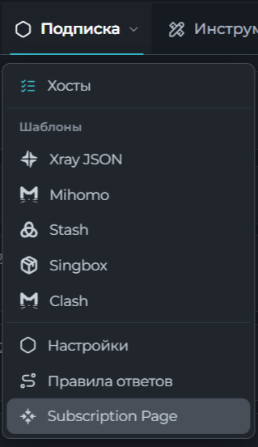
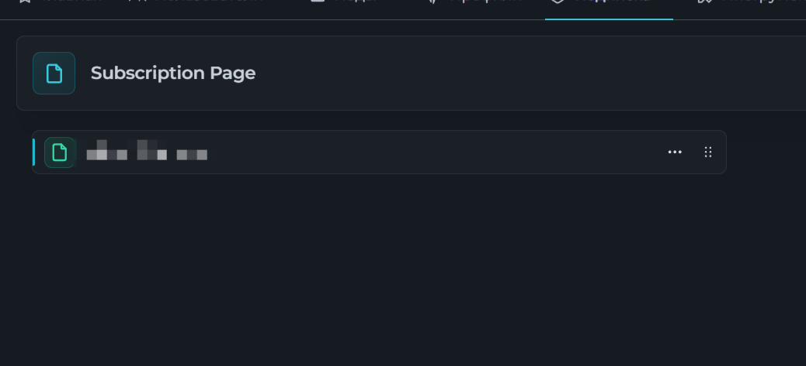
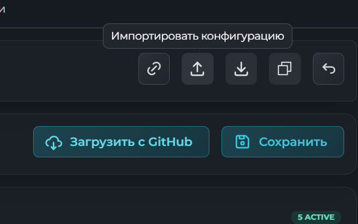
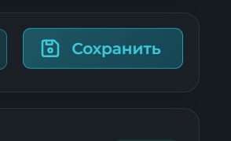

# Chumpy в Remnawave

Скачайте [subscription-page.json](subscription-page.json). В нём собраны стандартные приложения Remnawave, а Chumpy стоит первым на Android и Android TV.

1. В панели Remnawave откройте **Подписка → Subscription Page**.

   

2. Один раз нажмите на строку нужной конфигурации, чтобы открыть редактор.

   

3. Нажмите кнопку со стрелкой вверх **«Импортировать конфигурацию»**, выберите скачанный файл и нажмите **«Полный импорт»**. Этот режим заменяет открытую конфигурацию. Если у вас уже настроены свои приложения или оформление, сначала экспортируйте текущую конфигурацию.

   

4. Нажмите **«Сохранить»**, затем выполните на сервере, где запущена страница подписки:

   

   ```sh
   docker restart remnawave-subscription-page
   ```

Обновите страницу подписки и нажмите **«Открыть в Chumpy»**. Подтвердите добавление подписки в приложении.
